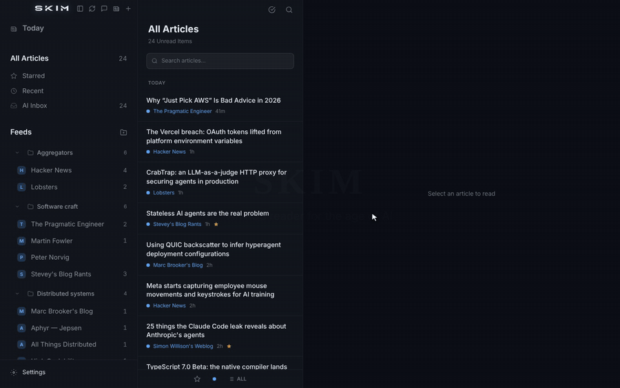

# Skim

**RSS reader for the age of AI.** Ingest feeds. Let a model triage the noise. Skim the rest.

<p align="center">
  <a href="docs/skim-walkthrough.mp4">
    
  </a>
  <br />
  <sub>Click for the full-resolution video.</sub>
</p>

---

## What it does

- **Today.** Your unread feeds laid out as one newspaper front page. Stories that several sources report are merged into one, with the source passages quoted. Turn the page to go back a week at a time (← and → on the Mac, swipe on iPhone and iPad).
- **Reader.** Sidebar, article list and a clean reader view in one window, with a Web tab for the original page.
- **Summarize.** A summary of the article you are reading, at the length and tone you pick.
- **Chat.** Ask follow-up questions about an article, a Today story, or the whole Today page.
- **AI Inbox.** A model scores every unread article for importance and for how well it fits your interests, and groups them by theme.
- **⌘K.** A command palette to jump anywhere. Type a question instead and Skim's assistant answers from your feeds.
- **Auto-organize.** The model proposes folders for your feeds; you review them before anything changes.
- **Your model.** Claude (API key or Pro/Max sign-in), OpenAI, Grok, OpenRouter, Ollama or any OpenAI-compatible endpoint. On a Mac you can also run a local model (MLX, llama.cpp, Apple Intelligence) with nothing leaving the machine.

Skim runs on macOS (Tauri) and on iPhone and iPad (native SwiftUI). Test builds of both go out through TestFlight.

## Run it

### Desktop (macOS)

```bash
./dev.sh          # installs Rust, pnpm and cmake via Homebrew if missing, then runs the app
```

or, with the toolchain already installed:

```bash
pnpm install
pnpm tauri dev
```

The desktop app is [Tauri 2](https://tauri.app) with a React frontend in `src/` and a Rust backend in `src-tauri/`. A signed, distributable `.app` comes from `./release.sh`; see [docs/MAC_RELEASE.md](docs/MAC_RELEASE.md).

### In a browser, without a Mac

The dev bridge serves the real Rust backend over HTTP so the UI runs in any browser, and two small local servers stand in for feeds and a model. See [docs/DEV_BROWSER.md](docs/DEV_BROWSER.md).

### iPhone and iPad

The iOS and iPadOS app is a separate SwiftUI app in `native/SkimNative`, built on the Swift `SkimCore` package. Generate the Xcode project with [XcodeGen](https://github.com/yonaskolb/XcodeGen) and open it:

```bash
cd native/SkimNative
xcodegen generate
open SkimNative.xcodeproj    # run the "Skim iOS" scheme
```

The `SkimMacOS` target there is a placeholder; the shipping Mac app is the Tauri one. [docs/MOBILE_DESKTOP_COMPARISON.md](docs/MOBILE_DESKTOP_COMPARISON.md) covers what each platform owns and what is shared.

### Tests

```bash
pnpm test                                          # frontend (Vitest)
cargo test --manifest-path src-tauri/Cargo.toml    # Rust backend
swift test --package-path native/SkimCore          # iOS core
```

### TestFlight

Copy `scripts/testflight.env.example` to `.env.testflight.local` and fill in your App Store Connect API key. Then:

Every TestFlight build gets a new version, on iOS and macOS alike, so each one shows up as a new entry in TestFlight. Both platforms share one version.

```bash
./scripts/bump-version.sh                # 0.1.53 -> 0.1.54, iOS and macOS build numbers +1
git commit -am "Bump to 0.1.54"          # merge the bump, then build and upload it:
SKIM_USE_COMMITTED_VERSION=true pnpm testflight   # iOS: archive and upload the "Skim iOS" scheme
./scripts/upload-macos-testflight.sh     # macOS: export the built Skim.app for TestFlight
```

Plain `pnpm testflight` uploads a bump that HEAD already carries as is; otherwise it bumps the version itself. It refuses to upload a build under an unchanged version (per-PR builds from `scripts/tf-pr.sh` are the exception).

## Setting up AI

Open **Settings → AI Provider**, choose a service and add a key or sign in. Local models on the Mac download from the same screen. How the provider settings are shared with other apps is in [docs/BYOS.md](docs/BYOS.md).

## Docs

- Product spec: [`skim.spec/`](skim.spec), one file per area, maintained with [Specify](https://github.com/gm2211/specify) (`scripts/specify.sh view --spec skim.spec`).
- README demo: the video and stills are generated by scripts in [`scripts/screenshots`](scripts/screenshots/README.md).

[MIT](LICENSE).

---

## AI content notice

Skim is an interface to AI models that **you choose and configure** (Anthropic, OpenAI, xAI, OpenRouter, Ollama, local MLX or llama.cpp, Apple Foundation Models, etc.). Summaries, chat replies, Today stories, and any other AI-generated text are produced by those third-party models — not by Skim.

AI output may be **inaccurate, biased, or hallucinated**. Always verify important details against the original sources. Skim does not produce, endorse, audit, or take responsibility for any AI-generated content. Your use of an AI provider through Skim is governed by that provider's terms and privacy policy.

See the full [Terms of Use](https://gm2211.github.io/skim/terms.html) and [Privacy Policy](https://gm2211.github.io/skim/privacy.html).
